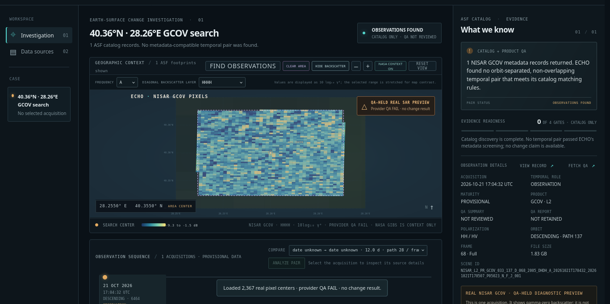

# Live NISAR GCOV interface path: end-to-end evidence

## Run

On 2026-11-07, a headless Firefox session used the ECHO interface to select a GCOV scene and submit its bounded area through the real `POST /api/gcov-preview` endpoint. The endpoint contacted ASF using the local Earthdata credentials and streamed the NISAR HDF5 window; the browser did not use a mock response.

- API result: HTTP 200
- Product: `NISAR_L2_PR_GCOV_033_137_D_068_2005_DHDH_A_20261021T170432_20261021T170507_P05023_N_F_J_001`
- Acquisition: 2026-10-21 17:04:32–17:05:07 UTC
- Dataset: `/science/LSAR/GCOV/grids/frequencyA/HHHH`
- AOI (WGS84): `[28.25, 40.35, 28.26, 40.36]`
- Grid: 56 × 43 pixels, EPSG:32635
- Display-eligible samples: 2,367 of 2,367 AOI pixel centers
- Provider QA: **FAIL**; the UI labels this as a QA-held diagnostic preview and shows no change result
- HTTP range bytes requested: 36,193,262

The live API response's grid metadata and all source-array checksums match the earlier direct-read record. The exact API response is preserved in [`real-gcov-window-preview-2026-11-07.json`](../../data/research/real-gcov-window-preview-2026-11-07.json), SHA-256 `e50ca2a84d3822976397433d777eb1f2202073a7fabdf85c7856aedd9c17e847`.

## Rendered evidence

The screenshot captures the actual returned raster at its geospatial AOI and the visible QA-held warning and evidence inspector:

Screenshot SHA-256: `397035778d34a01bd8e6e1a07a51998207337889c319b8d74324051f97b0d6e5`.

This verifies the data-access-to-map path for a single observation. Provider QA remains failed; this preview is diagnostic only and does not validate temporal change or event interpretation.

## Revalidation with 128 KiB range blocks

A new request through the local application's real `POST /api/gcov-preview` route returned HTTP 200 for the same scene and exact AOI. The selected window remained 56 × 43 pixels with 2,367 AOI pixel centers. The reader used 128 KiB blocks and requested 7,500,054 range bytes; the seven source/window/selection checksums are retained in [`nisar-live-preview-api-128kb-2026-11-07.json`](../../data/research/nisar-live-preview-api-128kb-2026-11-07.json). Provider QA remained **FAIL**, and the result remained `QA_HELD_DIAGNOSTIC_PREVIEW`.

A separate Firefox headless interaction selected the same scene from the timeline, drew an area on the map, and loaded the raster layer. The live page showed the QA-held inspector and rendered raster overlay. Because the screen-drawn rectangle resolved to a different AOI than the exact API request, its window was 54 × 61 pixels, with 3,193 centers and 7,500,078 range bytes. The capture harness incorrectly required the exact-API window's metrics and expected the literal text `QA FAIL`; the UI formats this as `PROVIDER QA` followed by `FAIL`. That assertion prevented retaining a new screenshot or full browser record, so this browser run is partial evidence. The exact request and measurement hashes above come from the successful direct API validation, not from this map-drawn AOI.
