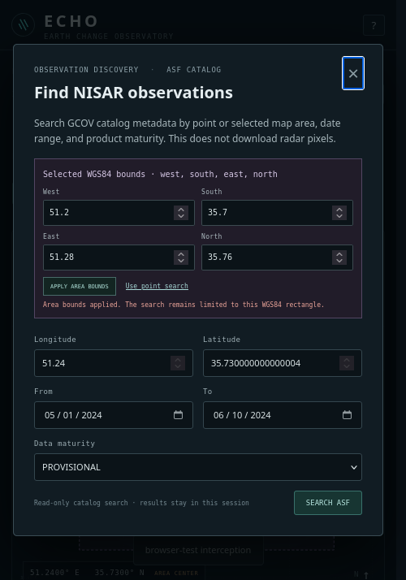
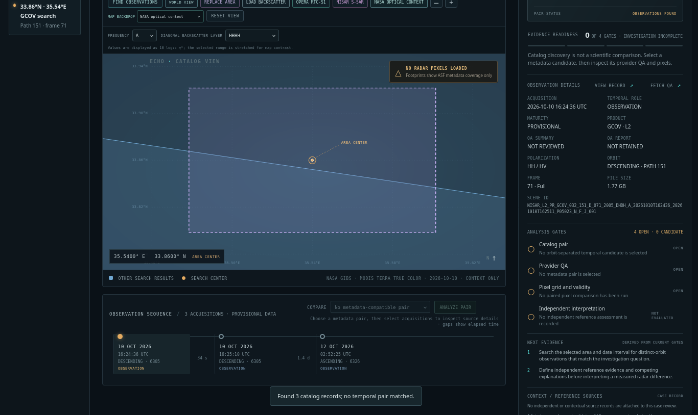
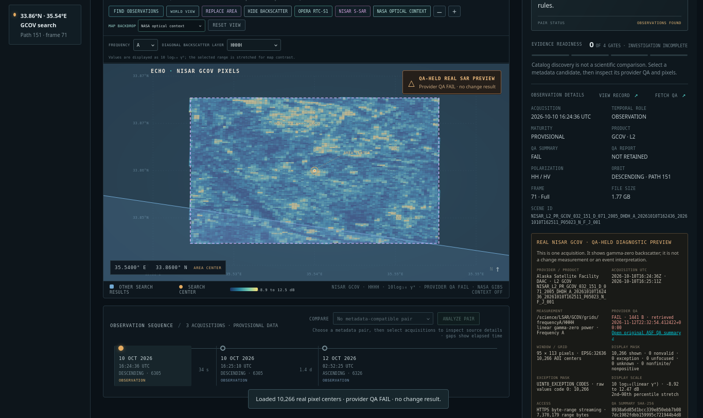
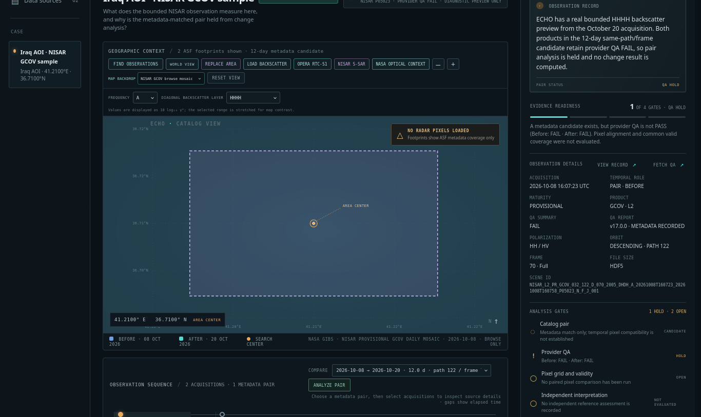

# Arbitrary AOI catalog search: browser verification

**Date:** 2026-11-13
**Application:** local interactive workbench at `127.0.0.1:8766`
**Browser:** Firefox headless, W3C WebDriver
**Scope:** map-drawn WGS84 area, editable catalog bounds, validation, and search handoff.

## Changes exercised

- Drawing a rectangle on the map creates editable west, south, east, and north
  WGS84 bounds in the ASF catalog dialog.
- Applying valid coordinates updates the map's area-center readout and disables
  the point-coordinate fields while area search is active.
- Invalid ordering and latitudes outside the WGS84 range are rejected with
  accessible field error states. Longitude and latitude limits, finite values,
  and the non-wrapping 180-degree longitude span are checked before use.
- Editing bounds and submitting without pressing **Apply area bounds** uses the
  values currently visible in the form. The submitted center and rectangle stay
  consistent.
- **Use point search** clears the selected area and re-enables point fields.
- A missing/unsupported catalog maturity now defaults to `PROVISIONAL` rather
  than leaving the selector blank.

## Browser results

Firefox exercised the complete map-draw → catalog dialog → edit → validate →
submit handoff at 1366×900 and 500×800. Both viewports produced map bounds,
rejected reversed longitude bounds and out-of-range latitude, submitted the
edited WGS84 rectangle, displayed its correct center, avoided horizontal page
overflow, and returned to point search when cleared. Point fields were disabled
while the rectangle was active; catalog maturity displayed `PROVISIONAL`.

The same desktop session then moved the selected area through four widely
separated locations—Beirut, Tokyo, Manaus, and Buenos Aires. At each location,
the map's coordinate readout matched the requested WGS84 center and the page
remained within the viewport. This checks geographic recentering across both
hemispheres; it does not prove satellite coverage or map-image availability at
those locations.

The browser harness intercepted `fetch` at the page boundary and recorded the
catalog request payload, then returned a controlled error. **No ASF or NASA
catalog request was sent.** For the edited bounds `[51.2, 35.7, 51.28, 35.76]`,
the captured request contained those same bounds and center `(51.24, 35.73)`.

## Live global NISAR discovery follow-up

A separate Firefox session opened the global WGS84 view from the Iraq case,
drew an initial Beirut-area rectangle, refined its coordinates numerically to
`[35.48, 33.80, 35.60, 33.92]`, set the date interval to 2026-10-01 through
2026-11-13 and maturity to `PROVISIONAL`, then submitted through the actual
catalog form. ASF returned three NISAR GCOV records on one page without a
truncation warning. The timeline and map updated to the returned acquisitions
and their footprints.

The three returned products were:

- `NISAR_L2_PR_GCOV_032_151_D_071_2005_DHDH_A_20261010T162436_20261010T162511_P05023_N_F_J_001`
- `NISAR_L2_PR_GCOV_032_151_D_072_2005_DHDH_A_20261010T162510_20261010T162544_P05023_N_F_J_001`
- `NISAR_L2_PR_GCOV_032_172_A_019_2005_DHDH_A_20261012T025225_20261012T025300_P05023_N_F_J_001`

ECHO reported **no metadata-compatible temporal pair** for this AOI. The two
same-path descending records are only 34 seconds apart and have different
frames; the later record is on another path and direction. Product QA and
measurement pixels were not requested or read. This verifies geographic
discovery and timeline integration, not a valid comparison or scientific
finding.

### Bounded real measurement preview

From that browser flow, the AOI was narrowed to `[35.53, 33.85, 35.55, 33.87]`
and the first observation was selected:
`NISAR_L2_PR_GCOV_032_151_D_071_2005_DHDH_A_20261010T162436_20261010T162511_P05023_N_F_J_001`.
ECHO retrieved and displayed a bounded, single-observation HHHH `γ⁰`
measurement: 10,266 pixel centers in a 95×113-pixel window, EPSG:32636. The
map raster aligned with the selected WGS84 window and the inspector retained
the source product and acquisition metadata.

ASF provider QA returned `FAIL`. ECHO kept the preview visibly QA-held and
stated that it is not a change result. No paired measurement, change layer, or
physical interpretation was produced. The live window retrieval took 113.7
seconds, so genuine arbitrary-area retrieval is demonstrated but remains slow.

The full measurement and provenance record is
[`beirut-nisar-gcov-diagnostic-preview-2026-11-13.json`](../../data/research/beirut-nisar-gcov-diagnostic-preview-2026-11-13.json)
(SHA-256 `12b0f1e1b0383706590932fcd7aa6900d5495db570104a73b647656499d32970`). It
retains the provider QA artifact hash, WGS84 and projected pixel coordinates,
measurement and quality arrays, per-array checksums, display transform, access
method, software version, and acquisition provenance. A second backend retrieval
for this archived record completed in 85.6 seconds; it returned the same product,
`FAIL` status, 10,266 AOI centers, and 7,370,179 requested range bytes. The
variation from the 113.7-second browser run reflects separate live retrievals,
not a controlled performance benchmark.

A local verification recomputed the SHA-256 values of all seven retained arrays
(`HHHH`, mask, looks, exception mask, x/y coordinates, and AOI selection mask);
all matched the archived record. The full automated suite then passed:
`.venv/bin/python -m pytest -q` — **498 passed**.

The Iraq case's separate NISAR GCOV browse backdrop also rendered in Firefox and
was labeled as a **provisional daily mosaic · browse only**. It is geographic
context, not the selected acquisition's measurement raster or evidence of
alignment with that product.

## Map backdrop state handling

The default T163 read-only case has no ASF catalog acquisitions in its saved
catalog record, so there is no selected acquisition date for a date-matched
NASA GIBS image. Its natural-earth geographic fallback was previously labeled
“satellite backdrop off” even while MODIS was selected. The attribution now
distinguishes `NASA GIBS DATE UNAVAILABLE` from an explicitly disabled backdrop
and from a failed GIBS request.

GIBS image errors already fell back to local coastline context; a request that
never resolved could leave the imagery layer blank indefinitely. A 12-second
image-load deadline now drops the stalled image, reports GIBS as unavailable,
and keeps the geographic fallback. Firefox exercised the controlled timeout
path and verified that the pending image was removed, local coastline geometry
remained visible, and the map selector explained how to retry. This timeout
path used a browser-controlled timer; it was not a measurement or a claim about
NASA service availability.

A separate fresh Firefox session selected the NISAR backdrop for the Iraq case.
That cold image request remained unresolved until the 12-second deadline; the
image was removed, the local coastline fallback rendered, and the attribution
reported `NASA GIBS UNAVAILABLE`. Another browser session had rendered the
browse mosaic successfully. These runs show variable service response, not a
stable availability guarantee. The optional backdrop does not determine SAR
measurement retrieval or QA.

## Verification limits

This verifies the browser interaction and request construction, not that every
provider accepts every rectangle, that catalog results cover the whole AOI, or
that any returned product passes provider QA. No measurements or scientific
findings were produced. Direct keyboard-only rectangle drawing and screen-reader
behavior remain outside this pass.
