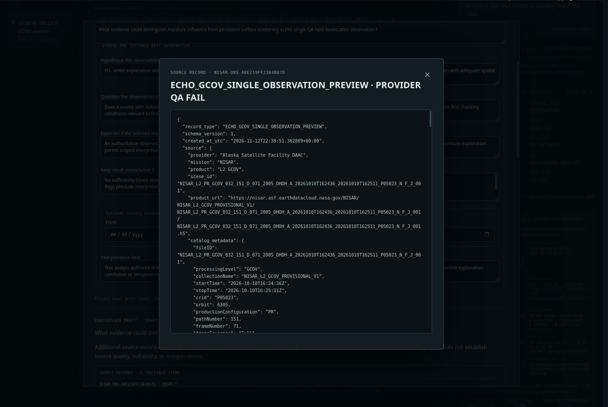

# Beirut NISAR observation to saved investigation draft

**Date:** 2026-11-13  
**Application:** isolated interactive local server at `127.0.0.1:8773`  
**Browser:** Firefox headless, W3C WebDriver, 1366 × 1000  
**Scope:** authentic single-scene preview → analyst draft → private snapshot → reload and source inspection.

## Result

Firefox completed the user-facing workflow using Beirut-area ASF catalog results
and the retained, checksummed NISAR GCOV preview for scene
`NISAR_L2_PR_GCOV_032_151_D_071_2005_DHDH_A_20261010T162436_20261010T162511_P05023_N_F_J_001`.
The catalog returned three records; the selected record was the same scene as
the retained measurement. The browser replayed that local measurement record
for this workflow, so this pass did not repeat the slow provider raster read.

The map rendered the measured pixel at row 12967, column 5069 with linear
γ⁰ `0.958313` (`−0.18 dB`), mask `1`, `7.295775890350342` looks, and exception
mask `0`. The preview continued to show `Provider QA FAIL · no change result`.

From the preview, the browser opened the source-linked draft form, entered two
analyst-authored competing explanations and one proposed next observation, and
submitted the draft. ECHO returned `DRAFT_NOT_ASSESSED`; both explanations
remained `NOT EVALUATED`, no evidence relationships were created, and the next
observation remained `NOT_SEARCHED`.

The draft was then saved as a checksummed private snapshot in an isolated
temporary XDG data directory, listed in the local-draft picker, and reopened
through the interface. ECHO rechecked snapshot integrity and current case
links. The reopened record retained `QA_HELD_DIAGNOSTIC_PREVIEW`, both
unevaluated explanations, and the proposed observation's `NOT_SEARCHED` state.
The source inspector independently showed the embedded source's provider QA as
`FAIL`.

During this browser check, the draft source inspector initially titled the
embedded NISAR record `STATUS NOT RECORDED` because the provider verdict is
nested under `source.provider_qa_status`. The inspector now resolves that
nested provider field and labels it `PROVIDER QA FAIL`, while leaving the JSON
record unchanged. Firefox verified the corrected title against the reopened
draft.

## Limits

This verifies local draft persistence and UI linkage for a QA-held, single-scene
record. It does not validate a temporal comparison, hypothesis, physical cause,
or independent corroboration. The source is a previously retrieved authentic
measurement record; no new raster was fetched in this pass. The local snapshot
was written only to a temporary test directory, not the user's normal draft
store.
