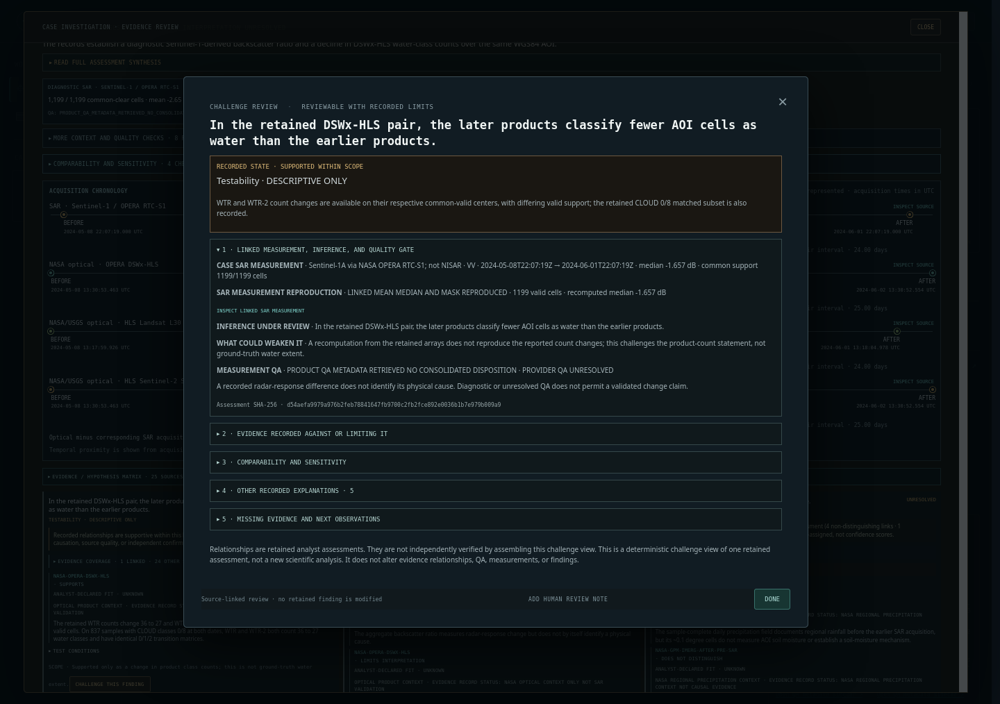

# Cross-sensor assessment and challenge workflow: Firefox verification

**Date:** 2026-11-13  
**Application:** local ECHO workbench at `127.0.0.1:8766`  
**Browser:** Firefox headless through W3C WebDriver  
**Case:** Rio Grande do Sul, T163, 2024 diagnostic case

## Browser workflow

Opened the case-linked investigation from the case header, then selected the
first recorded hypothesis challenge. The assessment loaded its retained SAR
and optical evidence, chronology, linked quality limits, and sensitivity
sections. The challenge dialog opened with the source-linked hypothesis and
showed its assessment disposition and testability.

The selected challenge states that later DSWx-HLS products classify fewer AOI
cells as water. ECHO labels the statement `SUPPORTED WITHIN SCOPE` and
`DESCRIPTIVE ONLY`; the dialog also states that its challenge view does not
independently verify the retained evidence relationships. It reproduces the
linked Sentinel-1/OPERA median log-ratio at −1.657 dB over 1,199 common cells
and explicitly retains unresolved provider QA. The optical classification is
not treated as ground truth, and no flood cause or validated event finding is
claimed.

This verifies the local UI-to-assessment-to-hypothesis-challenge path against
the retained checksum-linked case records. It does not create new measurements,
independently validate the source interpretations, or upgrade the diagnostic
products' QA disposition.
