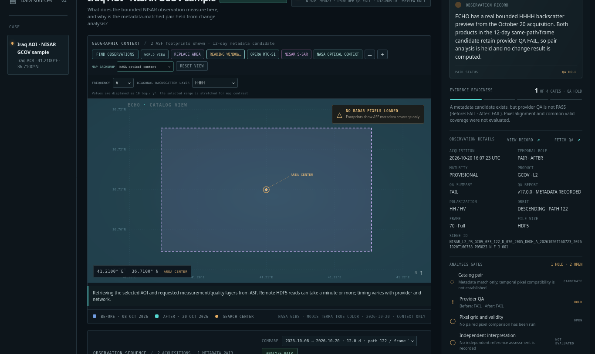
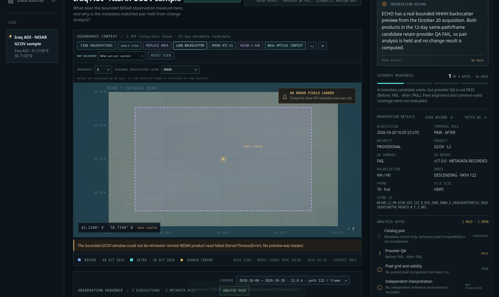

# NISAR bounded-window loading and error feedback

**Date:** 2026-11-13  
**Application:** existing local interactive workbench at `127.0.0.1:8766`  
**Browser:** Firefox headless, W3C WebDriver, 1366 × 900  
**Scope:** visible, accessible status during a delayed bounded preview, successful completion, and a controlled retrieval failure.

## Behavior added

The map now shows a persistent `role="status"` message while a GCOV window is
being retrieved. It explains that remote HDF5 reads can take a minute or more,
that the request is bounded to the selected area and requested measurement and
quality layers, and that elapsed time varies with provider and network. On
failure, the map retains an inline explanation after the short-lived toast
closes. It states that no preview was loaded. Starting a different selection
clears the old message.

## Browser verification

Firefox selected the Iraq case's October 20 NISAR scene and started the normal
map control. At the browser boundary, the `/api/gcov-preview` response was
delayed by 2.5 seconds, then supplied the retained authentic preview record.
During the delay, Firefox observed the live status, its accessible role, the
`aria-busy` button state, and the correct selected scene. On completion, the
status cleared and the preview remained `QA-HELD DIAGNOSTIC PREVIEW` with
provider QA `FAIL`. This was a controlled UI response, not a new provider read.

A second controlled browser request returned HTTP 502 with a simulated
`ServerTimeoutError`. The inline error remained visible, the button returned to
`LOAD BACKSCATTER`, `aria-busy` cleared, and no preview was rendered. This tests
the UI failure path; it is not evidence that ASF was unavailable or that a live
request timed out.

The timing copy is grounded in prior real Beirut range reads of 76.16, 85.6,
and 113.7 seconds. Those observations are not a benchmark or a service-level
guarantee; the [bounded AOI record](arbitrary-aoi-catalog-bounds-2026-11-13.md)
documents the retrievals and the unchanged production block size.
