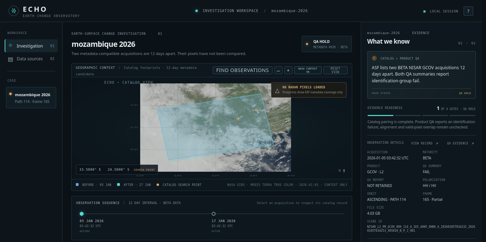

# NASA GIBS contextual basemap validation

**Date:** 2026-11-07

The ECHO local interface was served against the Southern Mozambique catalog case and opened in headless Firefox 158.0.1 with geckodriver 0.37.1.

## Observed

- The browser requested NASA GIBS `MODIS_Terra_CorrectedReflectance_TrueColor` through WMS 1.1.1, EPSG:4326, for the selected catalog acquisition date.
- NASA GIBS returned HTTP 200 `image/jpeg` for both case acquisition dates, 2026-01-05 and 2026-01-17. The rendered image was visible beneath the catalog footprint, coordinate grid, and search point.
- Selecting the second acquisition changed the WMS `TIME` parameter to 2026-01-17.
- The basemap toggle removed the external image while retaining the coordinate grid and catalog geometry.
- Dispatching an image error event exercised the fallback handler: the image element was removed and the map attribution changed to `NASA GIBS UNAVAILABLE · [date] · GRID SHOWN`. This validates the client fallback path; an actual GIBS outage was not induced.
- The QA HOLD and `NO RADAR PIXELS LOADED` state remained visible. The contextual image does not enter the SAR analysis pipeline.

## Limits

This validates browser display, date selection, toggle behavior, and graceful error handling for the current Southern Mozambique case. It does not establish global cartographic usability, arbitrary AOI navigation, SAR raster display, scientific validity of any event interpretation, or service availability for all dates and regions.
