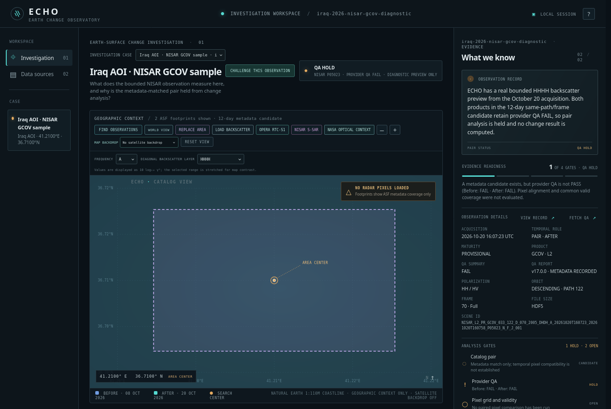
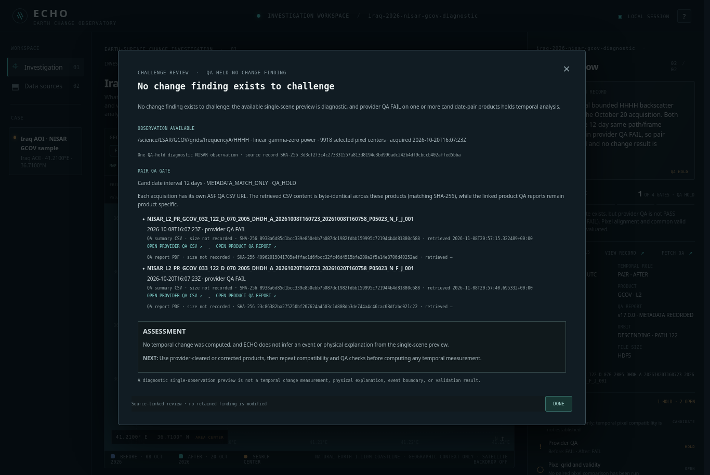
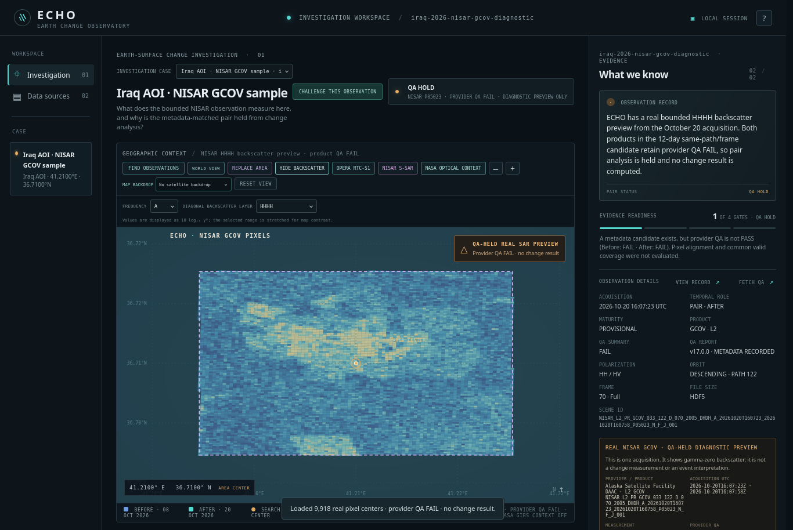

# Iraq investigation workflow audit — Firefox

**Date:** 2026-11-13

**Surface:** interactive local ECHO workbench at `127.0.0.1:8766`

**Browser / viewport:** Firefox headless, 1366 × 1000 CSS pixels

**Network:** external HTTP and HTTPS routed to an unreachable local proxy; map backdrop set to `OFF`

## User goal

Open the Iraq NISAR case, understand which observation is available, inspect why
temporal analysis is held, and deliberately challenge the interpretation.

Steps 1–4 used the retained local case and QA records; no measurement request,
draft mutation, or scientific recalculation was made in those steps. Step 5
made one bounded ASF measurement request. No draft was saved and no temporal
analysis was run.

## Steps and findings

1. **Open the Iraq case — health: corrected.** The first capture showed the
   October 8 `PAIR · BEFORE` scene selected while the case's retained
   single-scene preview and challenge target were from October 20. The map
   correctly said `NO RADAR PIXELS LOADED`; the sidebar disclosed that an
   October 20 preview exists, and `LOAD BACKSCATTER` was available. This was a
   context mismatch: the selected-scene metadata and the challenge subject
   referred to different acquisitions.

   

2. **Open “Challenge this observation” — health: scientifically sound, with
   the same context mismatch.** The panel stated that no change finding exists
   to challenge; it identified the 20 October measurement, source hash, QA
   status for both products, and the absence of temporal analysis or a physical
   explanation. The long product IDs and hashes are dense at this viewport, but
   remain available beside clear QA and assessment headings. The underlying
   timeline still showed October 8.

   

3. **Reopen after the selection fix — health: coherent.** When a case has a
   retained diagnostic preview, startup now selects that preview's scene if it
   exists in the catalog. The timeline and metadata panel both showed the
   October 20 `PAIR · AFTER` acquisition. The geographic map still said no
   pixels were loaded, which is accurate until the user requests a preview.
   Provider QA remained `FAIL`.

   

4. **Challenge the aligned observation — health: coherent and fail-closed.**
   The selected October 20 scene matched the challenge's acquisition timestamp.
   The panel retained `QA_HELD`, reported that no temporal change was computed,
   and made no physical-cause conclusion.

   

5. **Load the selected backscatter — health: functional, with provider latency.**
   The interactive workbench retrieved and rendered the actual October 20
   NISAR P05023 HHHH window for the selected WGS84 area. The bounded grid was
   92 × 113, with 9,918 AOI pixel centers in EPSG:32637; the browser reported
   7,351,192 range bytes. The map placed the raster inside the selected AOI.
   The UI labeled it `QA-HELD REAL SAR PREVIEW`, showed provider QA `FAIL`, and
   stated that no change result exists. This run took about 80 seconds.

   

## Change and verification

`renderWorkspace()` now prefers the case's recorded diagnostic-preview scene
when it must choose an initial selection. Cases without that preview retain the
existing metadata-pair `BEFORE` default. The focused Python regression passed
and a real Firefox run verified that the Iraq timeline, observation details,
and challenge report all identify the October 20 product. A second Firefox run
verified that Nepal, which has no retained single-scene preview, still opens
with its `PAIR · BEFORE` observation selected.

This audit covers one QA-held NISAR case and one no-preview pair-selection
regression. The live pixel request succeeded; the browser harness exited
nonzero only because its final assertion looked for `no change result` in the
map-attribution string, while ECHO presents that status in the QA-held raster
badge, toast, and measurement inspector. The recorded browser state and
inspected screenshot showed the raster, QA failure, and no-change status.
Screen-reader behavior and the entire interface remain outside this audit.
Both Iraq products remain provider-QA failed; no change conclusion was
produced.

## Reusable challenge smoke check

The read-only and interactive presentation of this QA boundary can be checked
without retrieving data or changing a draft:

```bash
.venv/bin/python tools/validation/check_observation_challenge_browser.py
```

The script requires a running local Firefox/geckodriver and loopback ECHO
workbench. It waits until the case review exposes **CHALLENGE THIS
OBSERVATION**, opens the retained challenge, and asserts that the panel says no
change finding exists, displays the provider QA failure, and reports that no
temporal change was computed. It also asserts one local GET, no browser page
errors, and no API writes.

On 2026-11-13 it passed against the running interactive Iraq case on port 8766
and the read-only Iraq case on port 8767. Both runs made one local GET to
`/api/adversarial-challenge?case_id=iraq-2026-nisar-gcov-diagnostic`; no
provider request, investigation mutation, or temporal calculation occurred.
This validates the interface's QA-held behavior, not the scientific cause of
any surface event.
