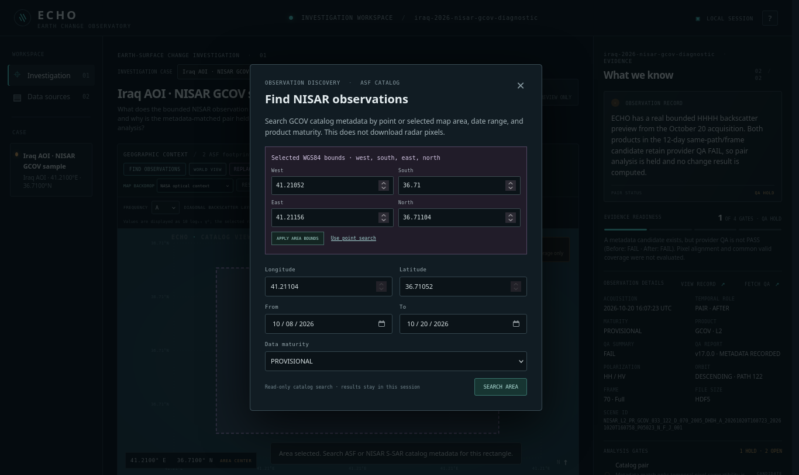

# Keyboard area selection — Firefox verification

**Date:** 2026-11-13  
**Application:** local interactive workbench, Iraq NISAR case  
**Browser:** Firefox 158.0.1 headless, 1366 × 900  
**Scope:** Keyboard-only map rectangle selection, WGS84 handoff to observation discovery, and cancellation.

The check is reproducible against a running local interactive workbench with
Firefox and `geckodriver` installed:

```bash
.venv/bin/python tools/validation/check_map_area_browser.py \
  --screenshot /tmp/echo-map-area-validation.png
```

It exercises keyboard and pointer selection, cancellation, and catalog-form
handoff. The script rejects non-loopback URLs, asserts that no catalog request
is submitted, and leaves no investigation record behind.

Selecting **SELECT AREA** now focuses the map and exposes the selection keys in
its accessible name and `aria-keyshortcuts`. Arrow keys move a visible map
cursor; **Enter** or **Space** sets each corner; **Shift + arrow** moves in a
larger step; **Escape** cancels and preserves the previous selection. Pointer
drag selection remains available. Bounds are rounded to eight decimal places
to avoid binary floating-point artifacts in the coordinate fields.

## Browser result

Firefox used real WebDriver keyboard actions to set a rectangle around the
current Iraq map area. The resulting catalog form displayed these WGS84 bounds
(west, south, east, north):

```text
41.21052, 36.71, 41.21156, 36.71104
```

Both point-coordinate inputs were disabled while the rectangle was active.
The browser then began replacing the selected area and pressed **Escape**;
reopening the catalog dialog showed the original four bounds unchanged. The
map returned to normal keyboard pan instructions after selection or
cancellation. No catalog search was submitted and no provider retrieval or
analysis was initiated.

A separate browser interaction switched to global view and drew a pointer
rectangle in the western and southern hemispheres. The resulting bounds were
`[-87.64133088, -37.47868812, -69.89118626, -28.04893162]` and appeared with
at most eight decimal places. This checks that precision formatting also
covers pointer selection and that WGS84 sign and ordering are retained outside
the Iraq case.



Screenshot SHA-256: `cd209725a748e14dc79ac144f847dab10c7924715253b0777d47abb6679b0571`.

This verifies keyboard and pointer interaction and map-to-form handoff at the
tested extents. It does not establish provider coverage, accessibility with
screen readers, or measurement suitability for the selected area.
