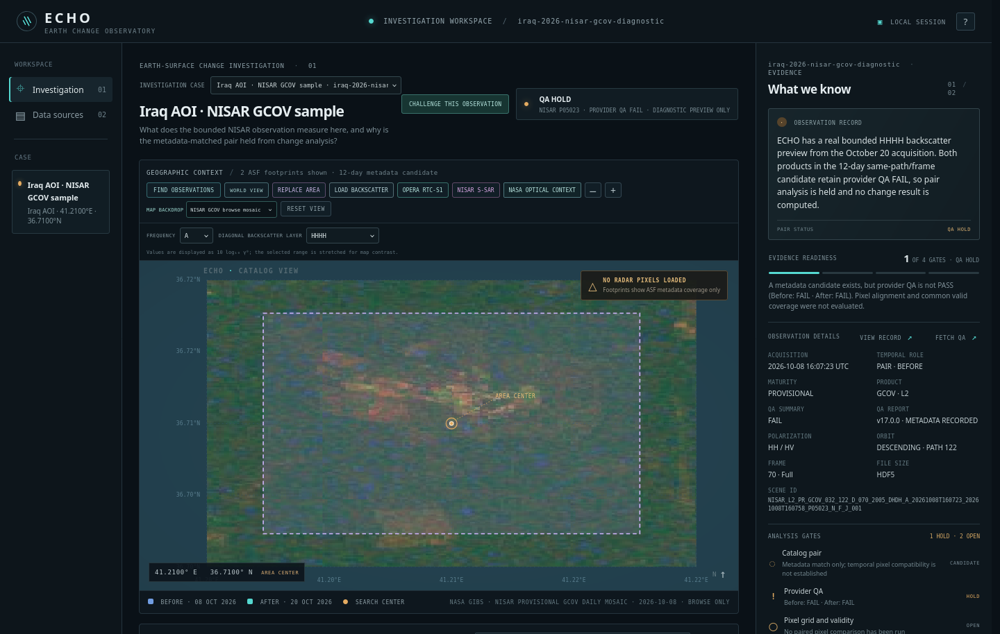

# NASA NISAR GCOV browse backdrop — Firefox verification

**Date:** 2026-11-13  
**Application:** local interactive workbench at `127.0.0.1:8766`  
**Browser:** Firefox 158.0.1, headless, through W3C WebDriver

## Results

In the Iraq case, the browser selected the **NISAR** map backdrop for
2026-10-08. The SVG image load event fired for the NASA GIBS WMS request at
WGS84 bounds `[41.197, 36.697, 41.223, 36.723]`. ECHO attributed the layer as
**NASA GIBS · NISAR PROVISIONAL GCOV DAILY MOSAIC · 2026-10-08 · BROWSE ONLY**.
The final browser capture was taken after the image load event; the image's
screen bounds filled the geographic plot beneath the case footprint and search
center. An earlier capture taken before the image finished loading was not used
to judge final rendering.

An independent local HTTP read of that exact WMS request returned HTTP 200,
`image/png`, a valid PNG signature, and the requested dimensions of 890×522
pixels (126,089 bytes). The browser session made no catalog, QA, or NISAR
measurement request; no case record changed.

## Scientific boundary

This verifies availability and browser loading of NASA's browse mosaic for the
tested date and viewport. The GIBS mosaic can combine provisional products with
different acquisition configurations; it is contextual imagery, not the
selected scene's quantitative raster, a controlled temporal comparison, or an
analysis input. It does not change the Iraq scene's provider QA `FAIL` or permit
a change conclusion.

