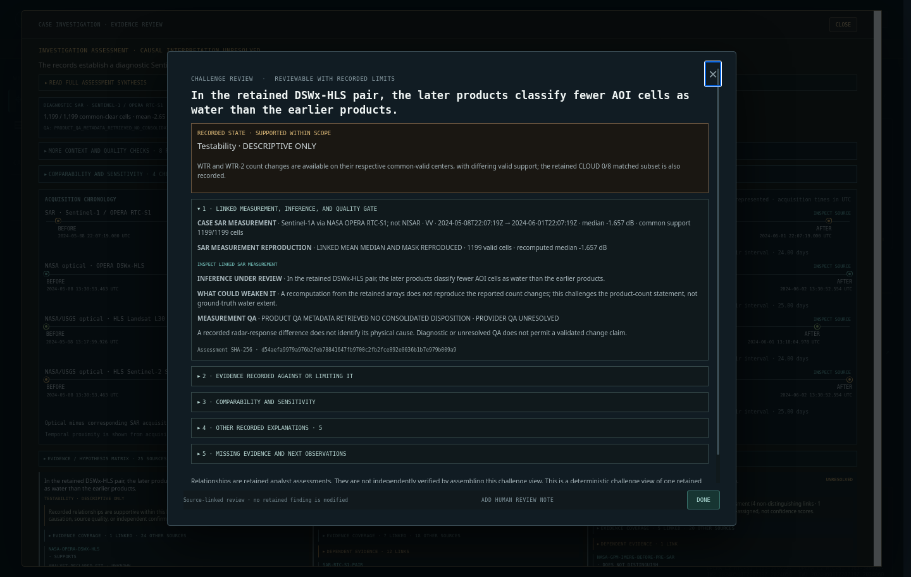

# Local investigation walkthrough with external networking blocked

**Date:** 2026-11-13  
**Application:** curated local demo at `127.0.0.1:8765`  
**Browser:** Firefox 158.0.1, headless, through W3C WebDriver

## Network isolation and user flow

Firefox was configured to send external HTTP and HTTPS traffic to an unreachable
loopback proxy (`127.0.0.1:9`) while bypassing the proxy for `localhost` and
`127.0.0.1`. ECHO remained reachable on loopback. In that session, the browser
opened the retained Rio Grande do Sul T163 case, opened its case investigation,
then selected a hypothesis challenge from the assessment. The case assessment
exposed six hypothesis challenge controls.

## What remained usable

- The case record and local map rendered; the map plot was 788 CSS pixels wide.
- The saved assessment and linked evidence loaded from the local curated bundle.
- The challenge view rendered its recorded DSWx-HLS water-class statement,
  linked Sentinel-1-derived NASA OPERA measurement and reproduction check,
  quality limits, evidence sections, alternative explanations, and missing
  evidence / next-observation section.
- No visible application error occurred during the interaction.
- The retained scientific labels remained scoped: Sentinel-1 via NASA OPERA,
  not NISAR; provider QA metadata has no consolidated disposition; the record
  is diagnostic and does not establish a physical cause or validated flood
  extent.

The retained challenge describes a supported-within-scope statement about
recorded product classifications while marking testability as descriptive
only. This is not a verified water extent or causal event conclusion. The
assessment as a whole remains causally unresolved.

This demonstrates one local, retained investigation workflow with external
networking unavailable. It does not prove every feature, fresh provider
retrieval, or the complete application is offline-capable. The test made no
provider request and changed no case record.
